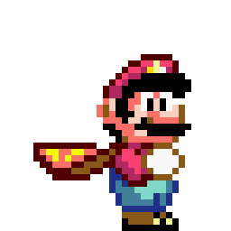

# Mario Jump

Mini game de estudo em que o Mario pula os canos, feito com HTML, CSS e JavaScript.

🔗 **Jogar:** https://matheusdiamantino.github.io/Mario-Bros/

## O que foi praticado

- Animações com **CSS keyframes** (cano, pulo e nuvens)
- JavaScript para o pulo e a detecção de colisão com `setInterval`
- Tela de game over trocando a imagem do personagem

## Como jogar

Abra o `index.html` no navegador e pressione qualquer tecla para pular.
